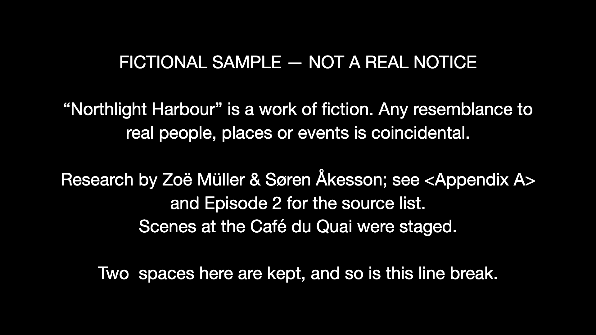
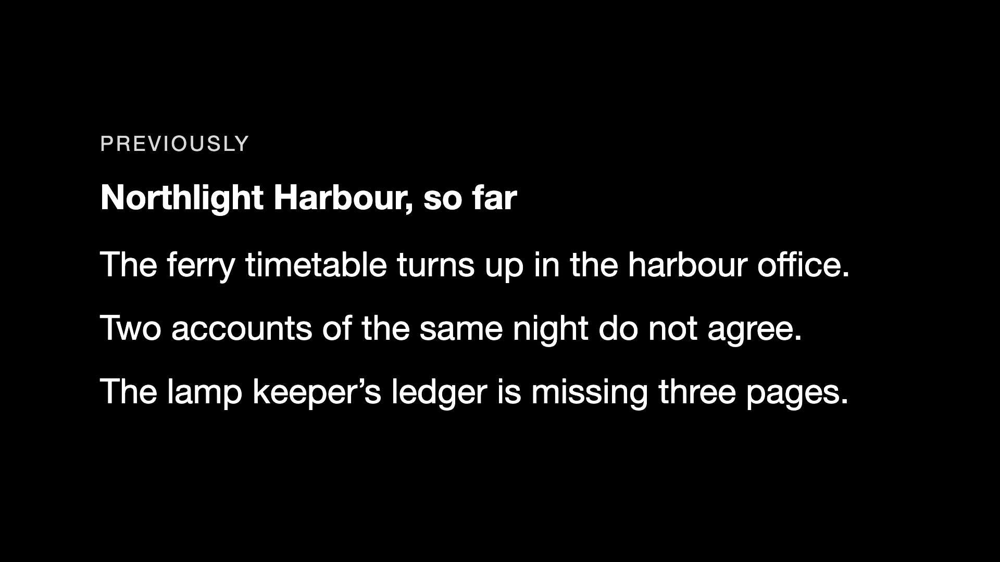
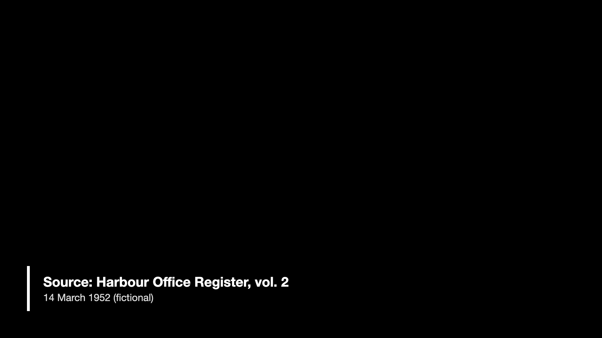

# remotion-cards-kit

> **Status:** a self-initiated proof project. All text is fictional. It is not client work and has not been used on a real film. See "Limits" for exactly what was and was not verified.

Props-driven cards for long-form video, built with [Remotion](https://www.remotion.dev): a **verbatim disclosure card**, a **removable recap card**, an end card and a source/date lower-third, laid out on an episode timeline from a **cue sheet**. JSON in, video out.

| Disclosure card (frame 0 of 192) | Recap card (frame 240 of 480) | Lower-third (episode frame 5100) |
|---|---|---|
|  |  |  |

## How it maps to the usual pass / fail test

| Criterion | How it is met | Evidence in this repo |
|---|---|---|
| Exact wording rendered from data | The text is a prop, validated and never transformed. It goes in as one React text child; CSS (`white-space: pre-wrap`) preserves line breaks and spacing. Only the font **size** is chosen by code. | `test/cards.test.tsx`: textContent equals the source byte for byte for 10 samples (curly quotes, em dash, non-breaking spaces, accents, `&`, `<...>`, double spaces, tabs, line breaks) |
| Correct hold | `holdSeconds` (default 8) x `fps` (24) = 192 frames, derived with `calculateMetadata`, never typed in twice | `test/duration.test.ts`; ffprobe of the render: 192 frames, 8.000 s |
| Clean toggle | `recap.enabled` and `featureCut` flags. Disabled modules add **zero frames** and leave **no gap**; later cues shift earlier by exactly the recap length | `test/timeline.test.ts`; decoded frames of the full-cut and feature-cut windows are identical (see Verification) |
| Legible | White on black (21:1, test requires at least 7:1); size is fitted to a safe area and **never goes below a floor** (36 px at 1080p). Text that cannot fit at the floor is an error, not a smaller font. A render-time check cancels the render if the real layout overflows | `test/fit.test.ts`; `DisclosureCard.tsx` overflow guard |
| No hard-coded text | Nothing but sample data in `data/*.json` contains wording | `grep -r "Northlight" src` finds nothing |
| No baked-in modules | Recap, end card and lower-third are separate compositions, placed only by the cue sheet | `src/lib/timeline.ts` |
| No decorative motion over legal text | There is **no animation anywhere**. The disclosure card does not read the current frame at all. | markup identical at frames 0, 1, 95, 191 (test); real stills at those frames are bit-identical (`npm run verify:static`) |

## Run it

Tested on Node v25.2.1 only. Needs a Chrome (the config uses the installed Google Chrome if present, otherwise Remotion fetches its own: `npx remotion browser ensure`).

```bash
npm install
npm test                 # 58 tests
npm run typecheck
npm run mutation-check   # breaks a temp copy in 14 ways; the suite must fail each time
npm run studio           # edit props live in Remotion Studio

npm run render:disclosure   # data/disclosure.sample.json -> out/disclosure-1080p.mp4 (8 s, 24 fps)
npm run render:recap        # data/recap.sample.json      -> out/recap-1080p.mp4 (20 s)
npm run render:4k           # disclosure at 3840x2160 (--scale=2)
npm run render:episode      # a window of the full episode, around the disclosure, with the guide track
npm run render:episode:feature-cut   # same moment of the programme, recap and end card removed
npm run verify:sync         # measures card start, hold and beep timing in the rendered files
npm run verify:static       # real stills at 4 frames must be bit-identical
```

Every render script takes its data from `--props=data/<file>.json`, so you can point it at your own file:

```bash
npx remotion render src/index.ts DisclosureCard out/mine.mp4 --props=data/my-notice.json
```

## A copy edit is a JSON edit

All wording lives in `data/`. To change the disclosure, edit `text` in the JSON and re-render. No code, no rebuild of components.

```json
{ "text": "Exactly this wording.\n\nIncluding this second paragraph.", "holdSeconds": 8, "fps": 24, "safeMargin": 0.1, "align": "center" }
```

Invalid data fails before any frame is rendered (zod): missing or blank text, a non-positive hold, a recap with no lines, a malformed timecode, two overlapping cues, a cue that runs past the end of the programme.

## Timing: the cue sheet and the guide track

`data/episode.sample.json` places cards by **timecode** (`HH:MM:SS:FF`, non-drop-frame):

```json
{ "id": "disclosure-ep1", "type": "disclosure", "at": "00:09:00:00", "text": "...", "holdSeconds": 8 }
```

`00:09:00:00` at 24 fps is frame 12960 (tested). To sync to a voice guide, take the cue times from the editor's markers for the guide track, write them into the cue sheet, and render. The guide track is played from the start of the programme.

**Placement model (chosen on purpose):** cue times are *programme time*, the time of the film itself. The recap is an insert before the programme and the end card an insert after it. With the recap on, the programme starts at frame 480 and the disclosure lands at 480 + 12960 = 13440. Switch the recap off and the programme starts at frame 0 and the disclosure lands at 12960, on the **same moment of the picture and the voice**. Absolute placement would leave the disclosure 20 seconds off the picture as soon as the recap is removed.

`npm run guide` generates a **test** guide track (no real audio): silence for the length of the programme with a 0.25 s 1 kHz beep at each cue. It exists so the sync can be measured instead of eyeballed.

## Verification (measured on the machine described below)

| Check | Result |
|---|---|
| `npm test` | 58 passed (6 files) |
| `npm run mutation-check` | 14 of 14 deliberate breakages caught (wording altered, fade added, slide added, spacing rule removed, toggle inverted, end card ignores the feature cut, cues not shifted, overlap guard removed, hold one frame short, timecode off by one, text colour below 7:1, legibility floor lowered, non-positive hold accepted, whitespace-only text accepted) |
| `disclosure-1080p.mp4` (ffprobe) | h264, 1920x1080, 24 fps, 192 frames, 8.000 s |
| `recap-1080p.mp4` | h264, 1920x1080, 24 fps, 480 frames, 20.000 s |
| `disclosure-4k.mp4` | h264, 3840x2160, 24 fps, 192 frames, 8.000 s |
| `verify:static` | stills at frames 0, 1, 95, 191 are bit-identical |
| `verify:sync` (full cut window) | card starts at frame 40 of the window = 1.667 s, held 192 frames = 8.000 s, beep starts 0.2 ms from the card (one frame is 41.7 ms) |
| `verify:sync` (feature-cut window) | same numbers; the card is at timeline frame 12960 instead of 13440 |
| Full cut vs feature cut windows | all 301 decoded video frames identical, so the toggle changes where the disclosure sits on the timeline and nothing about how it looks |

The episode renders are **windows** (`--frames=13400-13700`), not the whole 10-minute programme: this proves the placement and timing without rendering 15,000 mostly black frames. The `--frames` windows in `package.json` are guarded by a test that fails if the cue sheet moves the disclosure out of them.

## Notes on long 4K timelines

What was **verified here** (one Mac, Remotion 4.0.539):

- The flags used exist in this version: `--scale`, `--frames`, `--concurrency`, `--props`, `--codec`, `--crf`, `--every-nth-frame`, `--gl`, `--browser-executable` (checked against `npx remotion render --help`; the help lists names only, so the behaviour below is from measurement).
- `--scale=2` renders the 1920x1080 composition at 3840x2160 with the **same layout** (text breaks identically), so one set of props serves both sizes: 192 frames in 27.4 s wall, 237 kB.
- `--frames=A-B` renders a range. It is how the episode windows were made.
- `--concurrency` made **no measurable difference** here: 48 frames at 4K took 8.1 s, 8.7 s and 9.2 s at concurrency 1, 4 and 8 (single runs). These static frames cost almost nothing; the time is browser and bundle start-up. This says nothing about heavy compositions.
- Chunking: two 96-frame halves rendered separately at 4K and joined with `ffmpeg -f concat -c copy` gave a 192-frame 3840x2160 file, **but 22 of its 192 decoded frames differ from the single render** (lossy encoder differences at the join and in rate control). So chunked H.264 renders are not bit-identical to a single render. For bit-exact joins, render chunks to a lossless or intermediate format, or let Remotion do the stitching.

What is **recommended practice, not tested here**: rendering long episodes in chunks (frame ranges) and joining them; tuning concurrency to cores and memory on heavy compositions; moving renders to a larger machine or Remotion Lambda; keeping per-frame work cheap (no per-frame measurement, no large images re-decoded each frame). The static design of these cards (same markup on every frame) is what keeps them cheap, but a 90-minute 4K timeline was never rendered.

## Limits (read before relying on this)

- **Self-initiated demo, fictional text.** Not client work, not used on a real film, not reviewed by an editor or a rights lawyer.
- **Fonts:** a system font stack (`Helvetica Neue, Helvetica, Arial, ...`), so nothing is fetched at render time. A film's real typeface is not bundled or tested. Different fonts change line breaks, which is why the render **fails loudly** if the real layout overflows instead of silently shrinking text.
- The font fitting estimates line breaks with a conservative width model (no browser measurement) and is backed by that render-time overflow check. It is tuned for Latin text; right-to-left scripts and CJK were not tried.
- **Not tested:** a full-length episode, Remotion Lambda, a GPU renderer, alpha-channel output (ProRes 4444 / WebM) for overlaying a lower-third on picture, other frame rates in a real render (the timecode maths is tested at 24, 25 and 30), non-1920x1080 compositions, Windows or Linux.
- Only the installed Google Chrome was used for rendering. Remotion's own browser fallback (`npx remotion browser ensure`) was never exercised.
- Timecode is non-drop-frame. At 29.97 fps you would need drop-frame handling, which is not implemented.
- A recap switched off cannot be rendered on its own (Remotion cannot make a zero-frame video): `RecapCard` with `enabled: false` stops with a clear message. Inside an episode it adds zero frames.
- The guide track is a generated test signal, not speech. The sync measurement shows the **timeline** is correct; it does not align to a real recording's words.
- `npm audit` reports one advisory, in zod 3.x (memory exhaustion when validating oversized constrained collections), inherited by Remotion's studio packages. The kit only validates its own local JSON files, so it was left alone; zod 4 was not tried with this Remotion version.
- Render timings are from one Mac (8 cores, 8 GB) and single runs. They include Remotion's bundling step.

## Measured render times (single runs, wall clock, includes bundling)

| Script | Output | Time | Size |
|---|---|---|---|
| `render:disclosure` | 1080p, 192 frames | 21.2 s | 114 kB |
| `render:recap` | 1080p, 480 frames | 45.6 s | 170 kB |
| `render:episode` | 1080p window, 301 frames + audio | 30.7 s | 633 kB |
| `render:4k` | 3840x2160, 192 frames | 27.4 s | 237 kB |

## Layout

```
src/lib/        timecode, schemas (zod), font fitting, contrast, timeline builder (pure, unit-tested)
src/components/ DisclosureCard, RecapCard, EndCard, LowerThird, TextCard
src/EpisodeTimeline.tsx   lays the cards out from the cue sheet
src/Root.tsx    compositions, with durations derived from props (calculateMetadata)
data/           fictional sample text and cue sheets
test/           58 tests (vitest + jsdom)
scripts/        guide-track generator, sync and static verifiers, mutation check
docs/           the three stills above
```

## Environment used

macOS (Darwin 24.6.0), Node v25.2.1, npm 11.6.2, Remotion 4.0.539, React 19, TypeScript 7, Google Chrome 156.0.8078.76, ffmpeg/ffprobe from Homebrew.

## License

MIT
